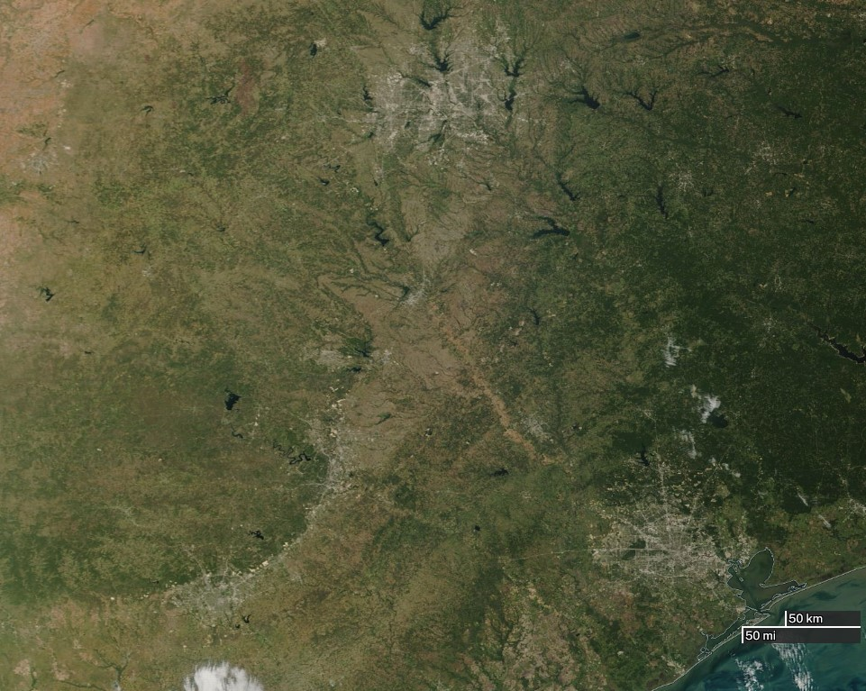
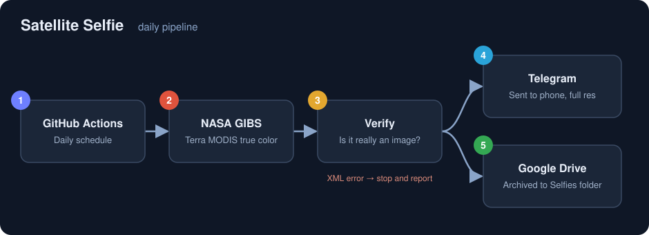

# Satellite Selfie

A daily satellite "selfie" of Southeast and Central Texas. Every morning, this project pulls yesterday's true-color satellite image from NASA, sends it to my phone through a Telegram bot, and archives it in Google Drive. It runs automatically on GitHub Actions, so no computer needs to stay on.



## How it works



1. **GitHub Actions** starts the script once a day on a schedule.
2. **NASA GIBS** returns yesterday's Terra MODIS Corrected Reflectance (true color) image for a fixed area, from about Del Rio to the Louisiana line and from the Gulf coast up toward Abilene and Tyler.
3. **Verify:** the script checks that the response is actually an image. WMS servers can return an XML error message with an HTTP 200 status, so a status check alone isn't enough. If it isn't an image, the run stops and reports the error.
4. **Telegram:** the image is sent to my phone as a document, so it arrives at full resolution.
5. **Google Drive:** the image is uploaded to a Drive folder as a long-term archive.

The image is downloaded once and kept in memory, so nothing is written to disk.

## Built with

- Python 3.12
- [`requests`](https://pypi.org/project/requests/) for the NASA and Telegram calls
- Google Drive API (`google-api-python-client`, `google-auth-oauthlib`) with the limited `drive.file` scope
- Telegram Bot API
- GitHub Actions for scheduling

## Setup

### 1. Telegram bot
1. Message **@BotFather** in Telegram, send `/newbot`, and save the token it gives you.
2. Send your new bot any message, then open `https://api.telegram.org/bot<TOKEN>/getUpdates` and copy the number in `"chat":{"id":...}`. That's your chat ID.

### 2. Google Drive
1. In Google Cloud Console, create a project and enable the **Google Drive API**.
2. Create OAuth credentials of type **Desktop app** and download the JSON file.
3. On the OAuth consent screen page, set the app to **In production**. Apps left in Testing mode issue tokens that expire after 7 days.
4. Run the script once locally. A browser window opens for sign-in, and a `token.json` file is created.

### 3. Run it locally
```
pip install -r requirements.txt
python selfie.py
```
Keep credentials in a `.env` file:
```
TELEGRAM_TOKEN=your-bot-token
TELEGRAM_CHAT_ID=your-chat-id
```

### 4. Run it on GitHub Actions
In the repo, go to **Settings → Secrets and variables → Actions** and add:

| Secret | Value |
|---|---|
| `TELEGRAM_TOKEN` | Bot token from BotFather |
| `TELEGRAM_CHAT_ID` | Your chat ID |
| `GOOGLE_TOKEN_JSON` | The full contents of `token.json` |

The workflow in `.github/workflows/selfie.yml` runs daily and can also be started by hand from the **Actions** tab with **Run workflow**.

## Security

`.env`, `token.json`, and the OAuth client file are listed in `.gitignore` and never committed. On GitHub, they live only in encrypted repository secrets.

## Credits

Imagery courtesy of NASA's Global Imagery Browse Services (GIBS), part of NASA's Earth Science Data and Information System (ESDIS).
